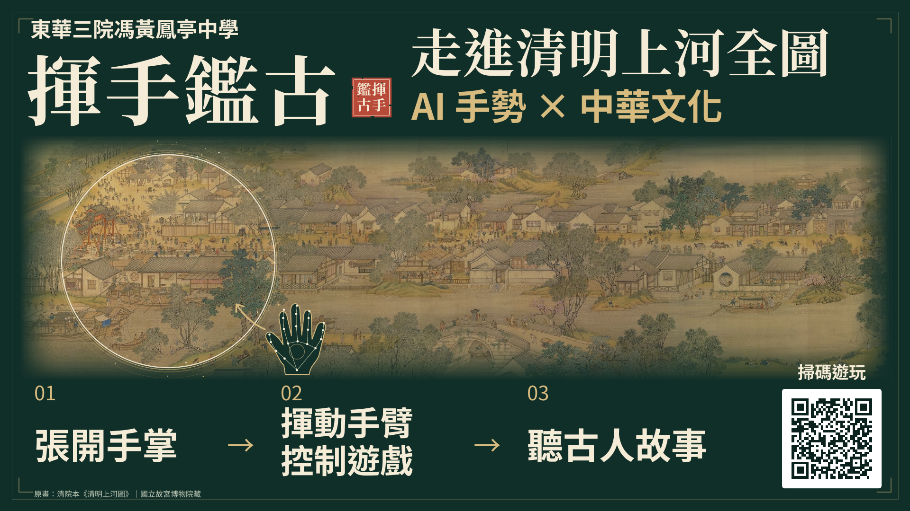
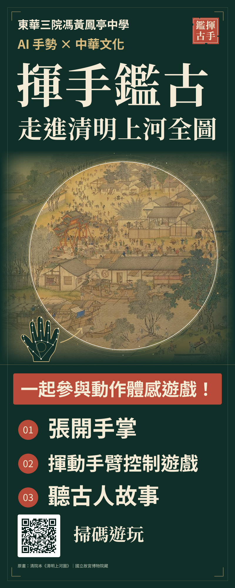

# 揮手鑑古｜尋寶清明上河圖

用手掌揮開迷霧，走入古畫尋寶。適合小朋友與家長一齊玩嘅廣東話網頁遊戲，亦展示 AI 點樣將鏡頭入面嘅手部關鍵點變成操作指令。

**[立即遊玩](https://yuenhk.github.io/qingming-hand-treasure/)** · 建議用電腦版 Chrome／Edge 配合鏡頭揮手；滑鼠只作輔助操作。

## 宣傳海報

東華三院馮黃鳳亭中學｜揮手鑑古 · 走進清明上河全圖



<a href="assets/posters/rollup.pdf"></a>

[易拉架印刷 PDF（80 × 200 cm，含 3 mm 出血）](assets/posters/rollup.pdf) · [電視 PDF](assets/posters/tv.pdf) · [Full HD 圖片](assets/posters/tv-preview.png) · [4K 圖片](assets/posters/tv-4k.png)

海報由本專案設計，採用原畫市集局部、手部關鍵點及遊戲 QR code。原畫來源見下方；海報內嵌 Noto 字型，授權見 [FONTS-LICENSE.txt](assets/posters/FONTS-LICENSE.txt)。

## 點樣玩

1. 開啟頁面並允許鏡頭後，介紹頁已可顯示實景與手勢。張開手掌，將光點移到「揮手入畫」，停留即可開始；亦可用滑鼠輔助。
2. 張開手掌移動光圈；家長可隨時用滑鼠輔助，滑鼠停低約三秒後，手勢可以接返。
3. 照住物件約兩秒，聽廣東話講解用途與畫中生活。每關搵齊兩件，五關共十件。
4. 通關後，光粒子消融灰幕，再用約 60 秒由城內到城外慢慢回望全彩長卷；背景分頁不會跳過回放。
5. 完成介紹後按「再玩一次」，直接重開第一關，鏡頭保持啟動。

「畫卷簡介」可重新打開介紹；右欄可開關音樂與講解。操作員按 C 可開啟鏡頭設定，按 R 重新開始。

## 畫卷與 AI

遊戲使用1736年由五位清宮畫家合作完成、國立故宮博物院收藏嘅「清院本《清明上河圖》」，與北宋張擇端本屬不同版本。主頁附[故宮作品資料](https://digitalarchive.npm.gov.tw/Collection/Detail/3782?dep=P)。路線由城門外、城內大街、街市、河岸園林到深處樓閣，係遊戲策展路線。

MediaPipe Hand Landmarker 找出手部21個關鍵點，程式再計算手掌位置、手指伸展程度及平滑軌跡。右欄直接顯示實景與骨架，方便理解 AI 與程式各自做緊乜。**鏡頭影像只在玩家瀏覽器處理，不錄影、不上傳，不需要帳戶。** 首次使用會下載本專案內嘅模型與素材。

廣東話講解為預先生成嘅本機 MP3；背景五聲音階配樂與尋寶音效由 Web Audio 即時合成，講解時音樂會自動降低。公開版使用原畫放大細節與自製光效，沒有轉載故宮動畫影片。

## 本機開發

需要 Python 3；修改與測試程式另需 Node.js 22。

```sh
python start_game.py
node --test tests/*.test.mjs
python scripts/build_site.py
```

不要直接以 file:// 開啟；鏡頭需要 HTTPS 或 localhost。手機可瀏覽介紹，遊戲介面以電腦橫向畫面為主。

- `chapters.js`：關卡、物件座標、廣東話描述。
- `portal.js`：光圈、尋寶、轉場與通關演出。
- `input-router.mjs`：滑鼠優先接手與手勢恢復規則。
- `camera.mjs`／`hand-worker.mjs`：鏡頭、關鍵點、背景 AI 推論。
- `game-audio.mjs`：配樂、提示音與廣東話播放。
- `site-files.json`：實際網站檔案與 SHA-256。更新程式或素材時，亦需同步更新相應雜湊值。

## 部署與素材

GitHub Pages 使用 `.github/workflows/pages.yml`：先跑自動測試，再校驗素材雜湊、建立 `dist/`、部署。Repository Settings → Pages 的 Source 設為 GitHub Actions。詳見[GitHub Pages 官方說明](https://docs.github.com/en/pages/getting-started-with-github-pages/using-custom-workflows-with-github-pages)。

原畫影像來自 [Wikimedia Commons](https://commons.wikimedia.org/wiki/File:QingMingShangHeTu_Big.jpg)，來源頁標示 Public Domain／PD-Art。原畫、套件及語音來源保留於 `assets/SOURCES.json`、`vendor/mediapipe/SOURCE.json` 及 `assets/narration/manifest.json`，MediaPipe 授權見 `vendor/mediapipe/LICENSE`。第三方素材各依原有授權；公開程式碼不代表所有素材均可任意另行授權。
